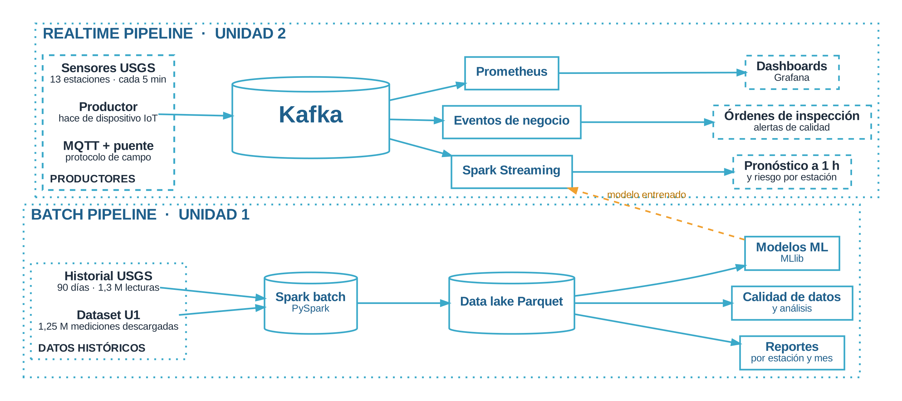
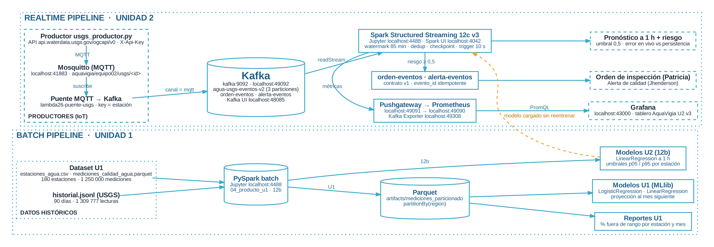
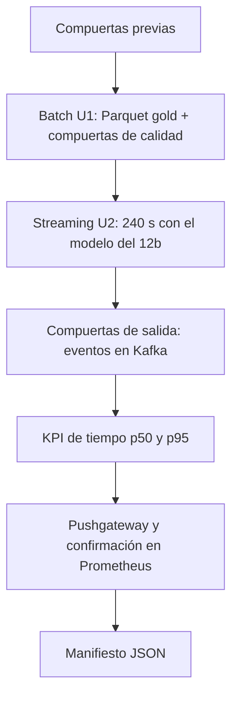
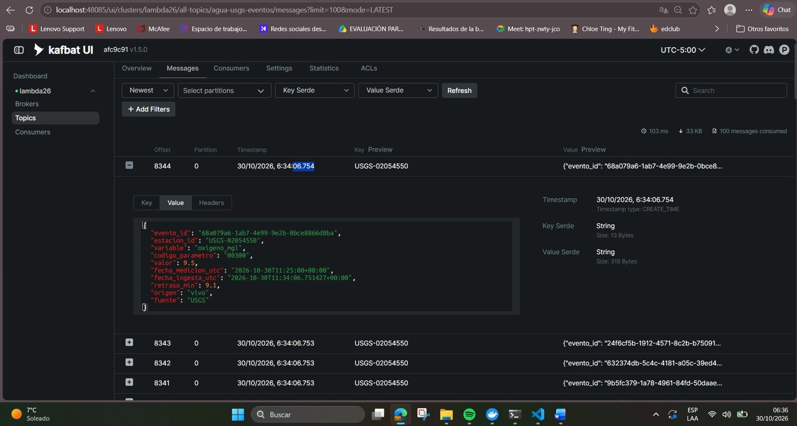

# Arquitectura

AquaVigía usa una arquitectura **Lambda**: una capa batch para el histórico y el entrenamiento, una capa de velocidad para las lecturas en vivo, y una capa de servicio común (Kafka para los eventos de negocio y Grafana para el tablero). Elegimos Lambda porque el caso necesita las dos cosas: tendencias y modelos sobre el histórico, y alertas sobre lo que está pasando ahora.

La arquitectura se muestra en dos niveles: una vista general y una vista detallada con los nombres de los componentes, las API y los puertos.

## Nivel 1: vista general

Los dos flujos corren **en paralelo**:

- **Batch (Unidad 1):** datos históricos → Spark batch → data lake en Parquet → modelos, calidad de datos y reportes.
- **Tiempo real (Unidad 2):** sensores del USGS → productor → MQTT y puente → Kafka → Spark Streaming → pronóstico y riesgo, eventos de negocio y métricas.

Se conectan en un punto: el modelo se entrena por lotes sobre el historial y Spark Streaming lo carga **sin reentrenar** (flecha discontinua).

## Nivel 2: vista detallada

| Componente | Imagen o código | Dirección dentro de Docker | Desde Windows |
|---|---|---|---|
| Productor del USGS | `usgs_productor.py` (Python en Windows) | | consulta `api.waterdata.usgs.gov/ogcapi/v0` |
| Mosquitto (MQTT) | `eclipse-mosquitto:2.0.20` | `mosquitto:1883` | `localhost:41883` |
| Puente MQTT a Kafka | `uso-agua-usgs/app/bridge_mqtt_kafka_usgs.py` | | |
| Kafka (modo KRaft) | `apache/kafka:4.3.1` | `kafka:9092` | `localhost:49092` |
| Kafka UI | `ghcr.io/kafbat/kafka-ui:v1.5.0` | | `localhost:48085` |
| Kafka Exporter | `danielqsj/kafka-exporter:v1.10.0` | `kafka-exporter:9308` | `localhost:49308` |
| PySpark 4.2 + Jupyter | `pyspark/Dockerfile` | | `localhost:4488` (Jupyter), `localhost:4042` (Spark UI) |
| Pushgateway | `prom/pushgateway:v1.11.1` | `pushgateway:9091` | `localhost:49091` |
| Prometheus | `prom/prometheus:v3.14.0` | `prometheus:9090` | `localhost:49090` |
| Grafana | `grafana/grafana:11.4.0` | `grafana:3000` | `localhost:43000` |

Las versiones exactas de todas las imágenes están en la [lista de comprobación](u3/hardening.md#2-lista-de-comprobacion-de-configuracion).

### Capa de integración (Unidad 3)

Los diagramas muestran los flujos de las Unidades 1 y 2. En la Unidad 3 se agregaron dos piezas que los envuelven:

- **Arranque ordenado** (`scripts/levantar.ps1`): cada servicio declara cuándo está listo (`healthcheck`) y los que dependen de otro esperan a que lo esté (`depends_on` con `service_healthy`).
- **Ejecución integrada** (cuaderno 13 de cada integrante): lee el Parquet gold de la U1, corre el streaming de la U2 con el modelo del 12b, publica eventos y métricas, y verifica cada paso con compuertas. El resultado aparece en la fila "Ejecución integrada U3" de Grafana.

## Carpetas principales

| Carpeta | Contenido |
|---|---|
| `kafka/` | Compose de Kafka, Kafka UI y Kafka Exporter |
| `pyspark/` | Imagen de PySpark con Jupyter y su Compose. `pyspark/sesiones/` se monta en `/opt` dentro del contenedor |
| `pyspark/sesiones/AquaVigia_Producto_U1/<integrante>/` | Cuaderno batch `04`, datos de entrada (`data/`) y artefactos (`artifacts/`, no versionado) |
| `pyspark/sesiones/AquaVigia_Producto_U2/<integrante>/` | Cuadernos `12a` a `12e`, productor del USGS, costos y tableros de la Unidad 2 |
| `pyspark/sesiones/AquaVigia_Producto_U2/data/` | `historial.jsonl` del USGS (no versionado) |
| `pyspark/sesiones/AquaVigia_Producto_U3/<integrante>/` | Cuaderno `13` de ejecución integrada y sus manifiestos (no versionados) |
| `obs/` | Prometheus, Pushgateway, Grafana y el tablero que Grafana carga al arrancar |
| `uso-agua-usgs/` | Mosquitto y el puente MQTT a Kafka |
| `scripts/` | Levantar el sistema, crear tópicos y probar la salud |
| `docs/` | Esta documentación (MkDocs) y las evidencias de la Unidad 3 |

## Decisiones técnicas y lo que cuestan

Cada decisión tiene un costo. Esta tabla dice por qué se tomó y qué se pierde con ella (S14, 3.9).

| Decisión | Por qué | Qué se pierde |
|---|---|---|
| Lambda y no Kappa | El modelo se entrena sobre 90 días de historial y el Parquet de la U1 se analiza por lotes. Reprocesar todo como stream no aportaba nada al caso. | Dos caminos que mantener (batch y streaming) y el riesgo de que den resultados distintos para el mismo dato. |
| Datos reales del USGS en la Unidad 2 | Con datos simulados no se puede medir el retraso real de publicación ni validar el modelo frente a lo que de verdad pasó. | Las estaciones son de Estados Unidos, no del Perú, y dependemos de que la API esté disponible. |
| MQTT y un puente, en lugar de escribir directo a Kafka | Un dispositivo de campo habla MQTT, no Kafka. El puente agrega la cabecera `canal=mqtt` y usa la estación como key. | Un servicio más que puede caerse (por eso reintenta) y unos milisegundos más de latencia. |
| 3 particiones con key `estacion_id` | Las lecturas de una estación quedan en orden dentro de su partición, y el consumo se puede repartir. | Si una estación envía mucho más que las otras, su partición se carga más (se ve en el panel "Mensajes por partición"). |
| Tiempo del evento = `fecha_medicion_utc` | El USGS publica con 40 a 54 minutos de retraso. La ventana y el watermark se basan en cuándo midió el sensor, no en cuándo llegó el dato. | Una ventana no se cierra hasta que pasa el watermark: los resultados por ventana salen con ese atraso. |
| Watermark de 85 minutos | Medido en el 12a: percentil 99 del retraso por 1,2. | Un dato que llegue con más de 85 minutos de atraso se descarta. Y el estado de Spark guarda 85 minutos de lecturas. |
| Deduplicación dentro del watermark | Kafka garantiza entrega "al menos una vez". Una lectura repetida no debe pronosticarse dos veces. | Memoria para recordar las claves vistas durante 85 minutos. |
| Inferencia sin estado | Cada evento trae su contexto (rezagos y variables simultáneas), así que una sola lectura basta para pronosticar y no hay estado que perder al reiniciar. | Los mensajes son más grandes y el productor debe calcular el contexto; si el contexto llega incompleto, esa lectura no se pronostica. |
| `evento_id` determinista (UUID v5) | Si un micro-lote se reprocesa, el evento de negocio tiene el mismo id y el consumidor puede descartarlo. | Dos alertas legítimas en el mismo bloque de 5 minutos tendrían el mismo id. La regla de 60 minutos sin repetir lo evita. |
| Pushgateway para las métricas de Spark | Un cuaderno no expone `/metrics` para que Prometheus lo lea, y la ejecución integrada corre y termina. | Prometheus no sabe si el dato es reciente: un valor viejo parece vivo. Por eso el tablero tiene el panel de antigüedad de la última ejecución. |
| Compuerta en el p50 de la latencia, no en el promedio | Una cola de mensajes acumulados infla el promedio sin describir al evento típico. El p95 solo advierte. | Más métricas y paneles que explicar. Y una advertencia del p95 puede ignorarse si nadie la revisa. |
| Compuertas que detienen la ejecución | Un resultado vacío o incompleto se detecta donde nace, como el Parquet al que le faltaban 3 regiones. | Una compuerta mal calibrada detiene un pipeline sano; por eso las comparaciones con la persistencia solo advierten. |
| Streaming acotado a 240 s en la ejecución integrada | Una ejecución integrada tiene que terminar para poder comprobarse y registrarse. | Cada corrida evalúa el modelo sobre unas 340 a 380 comparaciones por variable, no sobre días de operación. |
| Kafka sin volumen y sin autenticación | Es un laboratorio que se levanta desde cero con un script. | Los tópicos no sobreviven a recrear el contenedor, y cualquiera en la red local podría publicar. |

## Contratos de los eventos

**Evento de sensor, versión 2** (`agua-usgs-eventos-v2`, key = `estacion_id`):

| Campo | Significado |
|---|---|
| `version_esquema` | 2 |
| `evento_id` | identificador único |
| `estacion_id` | estación USGS, por ejemplo `USGS-01491000` |
| `variable`, `codigo_parametro` | `temperatura_c` (00010), `oxigeno_mgl` (00300), `ph` (00400), `turbidez_fnu` (63680), y también conductividad y nitrato |
| `valor` | lectura del sensor |
| `fecha_medicion_utc` | **tiempo del evento**: cuándo midió el sensor |
| `fecha_ingesta_utc`, `retraso_min` | cuándo llegó al pipeline y cuántos minutos después |
| `origen`, `fuente` | `vivo`, `historial` o `reproduccion`; `USGS` |
| `contexto.rezagos` | la misma variable 5, 10, 15, 30 y 60 minutos antes (`l1`, `l2`, `l3`, `l6`, `l12`) |
| `contexto.simultaneas` | las otras variables de la estación en el mismo bloque de 5 minutos |

Un consumidor de la versión 1 sigue funcionando: solo ignora `contexto`.

**Evento de negocio, versión 1** (`orden-eventos` y `alerta-eventos`, key = `estacion_id|variable`):

| Campo | Significado |
|---|---|
| `evento_id` | UUID v5 de tipo, estación, variable y bloque de 5 minutos (idempotente) |
| `tipo`, `integrante` | `orden_inspeccion` (Patricia) o `alerta_calidad` (Jhenderson) |
| `estacion_id`, `variable` | dónde y qué |
| `valor_actual`, `pronostico_1h`, `riesgo` | el dato, el pronóstico a una hora y la probabilidad de salir del rango |
| `umbral_p05`, `umbral_p95`, `direccion` | rango de la estación y qué lado preocupa |
| `ts_medicion_utc`, `creado_utc`, `estado` | cuándo se midió, cuándo se creó el evento y su estado (`creada`) |
| `modelo`, `evento_origen_id`, `runId` | modelo que pronosticó, lectura que lo originó y corrida |

Regla de negocio: no se repite el evento para la misma estación y variable antes de 60 minutos.
