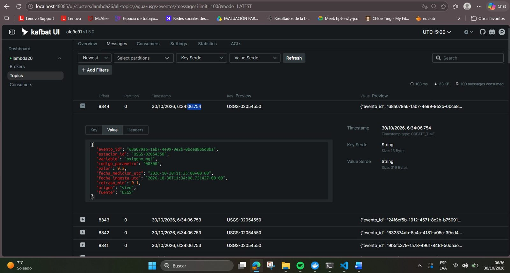

# Arquitectura Lambda

```
USGS (sensores reales, API pública)
   |  historial de 90 días  ->  data/historial.jsonl   (capa batch: entrenamiento)
   |  lecturas nuevas cada 120 s
   v
Kafka: agua-usgs-eventos (1 partición, key = estacion_id)
   v
Spark Structured Streaming
   ventana 15 min + watermark 85 min + checkpoint
   modelo de pronóstico a 1 hora  ->  riesgo de salir del rango
   |                         |                                  |
Parquet               Kafka: orden-eventos / alerta-eventos   Pushgateway
                                                                 |
kafka-exporter  ->  Prometheus  <---------- scrape --------------+
                        |
                    Grafana (tablero único del equipo)
```

- **Capa batch:** historial de 90 días (1 309 777 lecturas en 13 estaciones) para entrenar los modelos.
- **Capa de velocidad:** lecturas nuevas del USGS a Kafka cada 120 segundos, procesadas por Spark.
- **Capa de servicio:** Grafana, con KPIs del flujo, pronóstico y riesgo en la misma pantalla.

## Contrato del evento de sensor



| Campo | Tipo | Significado |
|---|---|---|
| `evento_id` | string | identificador único |
| `estacion_id` | string | estación USGS, por ejemplo `USGS-01491000` |
| `variable` | string | ph, oxigeno_mgl, turbidez_fnu, temperatura_c, conductividad_uscm, nitrato_mgl |
| `codigo_parametro` | string | código USGS del parámetro |
| `valor` | double | lectura del sensor |
| `fecha_medicion_utc` | ISO-8601 | **tiempo del evento**: cuándo midió el sensor |
| `fecha_ingesta_utc` | ISO-8601 | cuándo llegó a nuestro pipeline |
| `retraso_min` | double | minutos entre medición e ingesta |
| `origen` | string | vivo, historial o reproducción |
| `fuente` | string | USGS |

El tiempo del evento es `fecha_medicion_utc`, no la hora de llegada: es la base de la ventana y del watermark.

## Infraestructura

Contenedores Docker: Kafka 4.3 (creación automática de tópicos desactivada), Kafka UI, kafka-exporter, PySpark 4.2 con Jupyter, Pushgateway, Prometheus 3.14 y Grafana 11.4.
