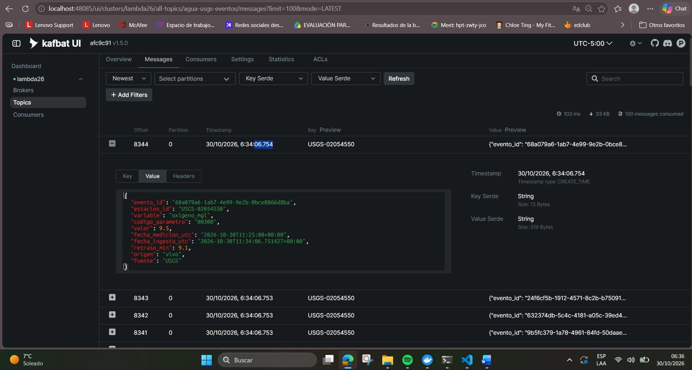
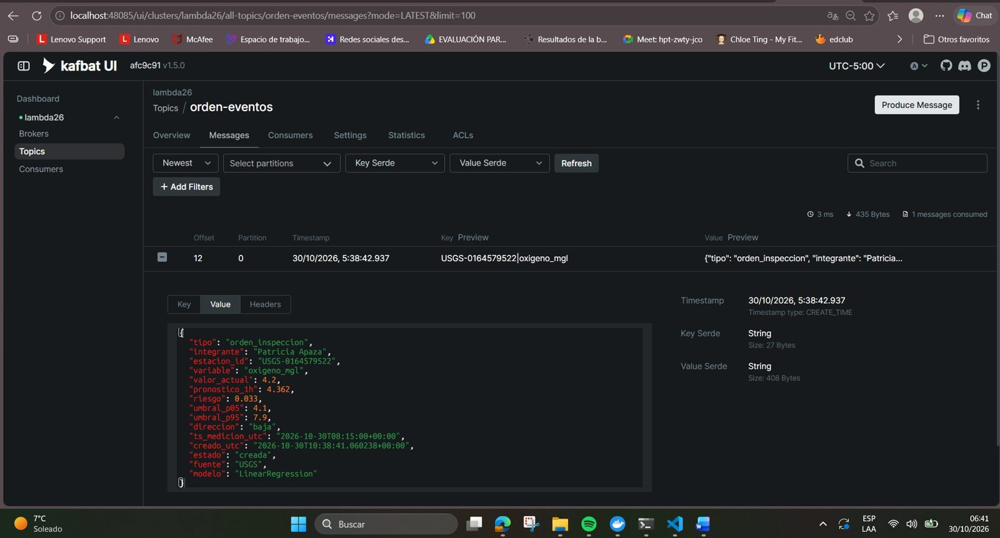
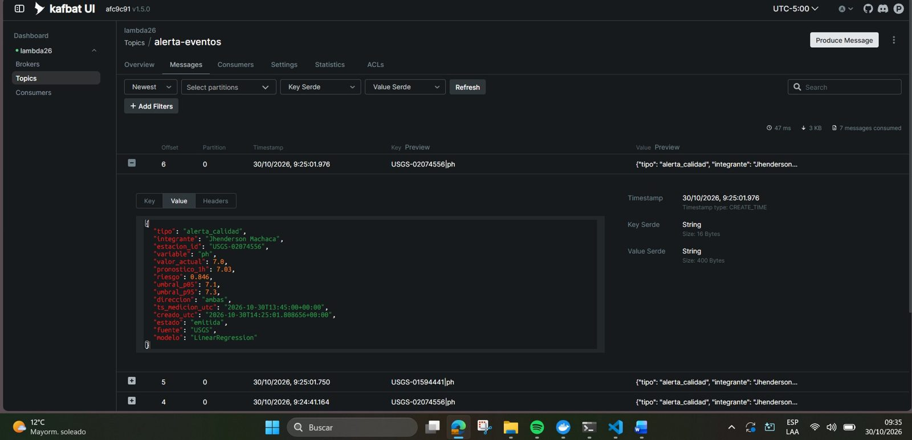
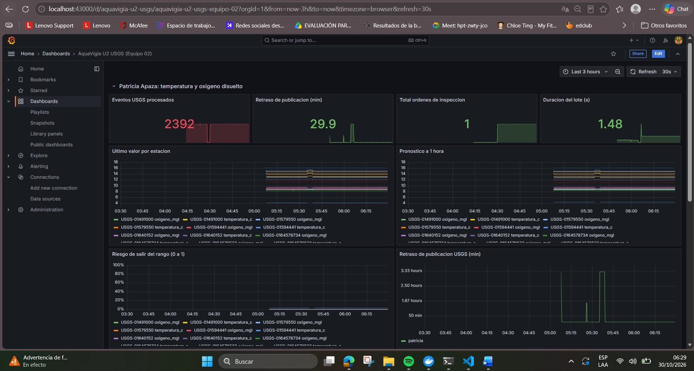
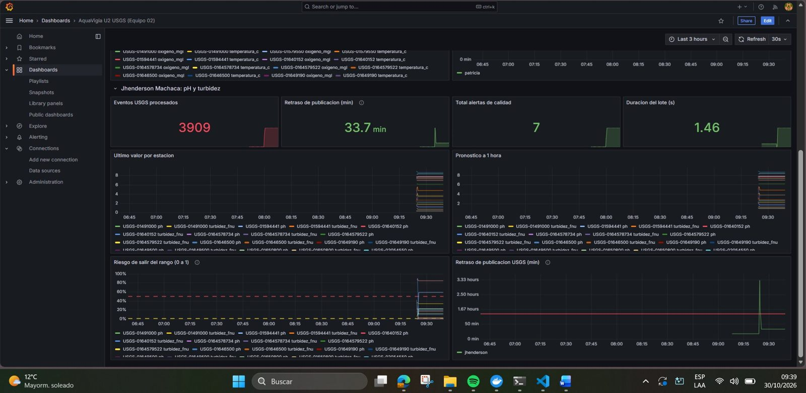

# Pruebas y evidencias

Esta página reúne qué se probó, cómo y qué salió. Cada fila enlaza a la evidencia completa. Los números son los de las ejecuciones reales del equipo; no hay valores de ejemplo.

## 1. Sistema integrado (Unidad 3)

Detalle en [Ejecución integrada](u3/integracion.md).

| Prueba | Resultado | Evidencia |
|---|---|---|
| Ejecución integrada de Patricia (batch, streaming, modelo, eventos y métricas juntos) | 3 corridas completas, todas con 21 de 21 compuertas. La del episodio dio 971 pronósticos, 4 órdenes confirmadas en Kafka y riesgo máximo 0,745 | [integracion.md, sección 4](u3/integracion.md#4-corridas-y-comparacion-de-manifiestos) y manifiestos |
| Ejecución integrada de Jhenderson | 2 corridas completas con 21 de 21 compuertas: 1 043 y 1 077 pronósticos, 15 y 16 alertas confirmadas en Kafka | Ídem |
| **Caso de error**: Parquet gold incompleto | La compuerta de completitud detuvo la corrida en la sección 2 (794 866 de 1 245 817 filas; faltaban 3 regiones). Las demás compuertas pasaban: solo la de completitud lo detectó. Se regeneró el gold y la corrida siguiente pasó | [salida de la corrida fallida](https://github.com/Patricia-Apaza/Big-Data-Contaminacion-del-Agua-/blob/main/docs/u3/evidencias/jhenderson_corrida_fallida_20261113T110211Z.txt) y [bitácora, fila 1](u3/integracion.md#5-bitacora-de-integracion) |
| Comparación de dos corridas por manifiesto | Mismo procedimiento y compuertas; cambian las lecturas y por eso los pronósticos y eventos | [integracion.md, sección 4](u3/integracion.md#4-corridas-y-comparacion-de-manifiestos) |
| Métricas confirmadas en Prometheus | En cada corrida, las 15 métricas publicadas se leyeron de vuelta con el mismo valor | Sección 5 de cada cuaderno 13 |
| Latencia de punta a punta (Kafka → pronóstico) | p50 entre 6,7 y 7,5 s; p95 entre 11,3 y 11,9 s; ningún evento sobre 1 minuto | Manifiestos |
| Error del modelo en vivo frente a repetir el último valor | Con más de 300 comparaciones por variable, el modelo tuvo menor RMSE en las cuatro variables. Con solo 69 (corrida 1 de Patricia), la persistencia ganó en temperatura y quedó como advertencia | Manifiestos e [integracion.md](u3/integracion.md#corridas-de-patricia) |

## 2. Hardening y no regresión (Unidad 3)

Detalle en [Hardening y revisión técnica](u3/hardening.md).

| Prueba | Resultado | Evidencia |
|---|---|---|
| Comandos de salud probados a mano antes de usarlos | 8 de 8 terminaron con código 0 | `healthchecks_prueba_manual.txt` |
| Arranque ordenado con `levantar.ps1` | Terminó sin error y los 8 servicios con comprobación de salud quedaron `(healthy)` | `docker_ps_despues.txt` |
| Credenciales por variable de entorno | `config` muestra `admin` sin variable y el valor nuevo con `GRAFANA_ADMIN_PASSWORD` | `grafana_variable_prueba.txt` |
| Puente con Kafka caído | 3 reintentos `kafka_no_disponible`, luego `connected` y `healthy` sin intervención | `puente_reintento_prueba.txt` |
| No regresión antes y después del hardening | Mismas compuertas (21 de 21), mismos eventos confirmados, mismo riesgo máximo, error en vivo igual al tercer decimal | [hardening.md, sección 5](u3/hardening.md#5-prueba-de-no-regresion) |

Los archivos `.txt` están en [`docs/u3/evidencias/`](https://github.com/Patricia-Apaza/Big-Data-Contaminacion-del-Agua-/tree/main/docs/u3/evidencias).

## 3. Batch (Unidad 1)

| Prueba | Resultado | Dónde |
|---|---|---|
| Esquema validado | Columnas obligatorias presentes | `04`, sección 3 |
| Duplicados | 1 250 000 → 1 245 817 filas | `04`, sección 3 |
| Escritura y lectura del Parquet sin pérdida | `Verificado: 1,245,817 filas, ida y vuelta sin perdida.` | `04`, sección 3 |
| Poda de particiones | El plan físico muestra `PartitionFilters: [isnotnull(region), (region = Puno)]` | `04`, sección 3 |
| Modelo de Patricia (alerta del mes siguiente) | AUC 0,509: no separa mejor que el azar. Se declaró que no debe usarse para priorizar | `04` de Patricia, sección 4 |
| Modelo de Jhenderson (pH del mes siguiente) | RMSE 0,0355 con R² 0,0008: el pH mensual es casi constante y el modelo no capta una tendencia | `04` de Jhenderson, sección 4 |

## 4. Tiempo real (Unidad 2)

Detalle en las páginas de la Unidad 2 de [Patricia](patricia/u2-producto.md) y [Jhenderson](jhenderson/u2-producto.md).

| Prueba | Resultado |
|---|---|
| Watermark medido, no supuesto | 85 minutos: percentil 99 del retraso real de publicación por 1,2 |
| Checkpoint | Al reiniciar con el mismo checkpoint, el `batchId` continúa y no vuelve a 0 (Patricia: sigue en 4; Jhenderson: en 5) |
| Dato tardío | Una lectura con 500 minutos de atraso no entra con watermark y sí entra sin él |
| Deduplicación | Reenvío de 50 lecturas: +50 sin deduplicar, +0 con deduplicación (12d) |
| Modelo de series de tiempo frente a repetir el último valor (validación del 12b) | Mejora de RMSE: temperatura 45,1 %, oxígeno 32,1 %, pH 9,4 %, turbidez 4,2 % |

## 5. Métricas para la demostración

Cada cifra que se dice en la demostración se puede señalar en un manifiesto o en Prometheus (S14, 3.7). Valores de las últimas corridas: Patricia `20261113T163113Z` y Jhenderson `20261113T163824Z`, las dos con el episodio del 16 al 17 de octubre.

| Métrica | Patricia | Jhenderson | Origen: campo del manifiesto · métrica en Prometheus |
|---|---|---|---|
| Filas del Parquet gold de la U1 | 1 245 817 | 1 245 817 | `batch.filas` · `aquavigia_int_batch_filas` |
| Indicador de la U1 | 22,56 % fuera de rango (281 071) | 86,54 % pH aceptable; 11,76 % ácido; 1,70 % fuera de rango | `batch.indicadorU1` |
| Mediana (p50) y p95 del batch | temperatura 16,0 y 25,0 °C; oxígeno 7,0 y 9,63 mg/L | pH 7,20 y 8,19; turbidez 4,15 y 17,97 NTU | `batch.kpi` |
| Compuertas que pasaron | 21 de 21 | 21 de 21 | `compuertasPrevias`, `batch.calidad`, `streaming.compuertas`, `kpiTiempo.compuertas` · `aquavigia_int_compuertas_ok` |
| Pronósticos en 240 s de streaming | 1 015 | 1 077 | `streaming.pronosticos` · `aquavigia_int_stream_pronosticos` |
| Eventos de negocio emitidos (confirmados en Kafka) | 4 órdenes (4) | 16 alertas (16) | `streaming.eventosNegocio` y `eventosNegocioEnKafka` · `aquavigia_int_eventos_negocio` |
| Riesgo máximo | 0,745 | 1,000 | `streaming.riesgoMax` · `aquavigia_int_riesgo_max` |
| Latencia de punta a punta p50 / p95 / máx. | 6,7 / 11,3 / 12,1 s | 7,0 / 11,4 / 12,3 s | `kpiTiempo.latenciaPuntaAPunta` · `aquavigia_int_latencia_p50_s`, `_p95_s` |
| Eventos con más de 1 minuto de latencia | 0 % | 0 % | `kpiTiempo.latenciaPuntaAPunta.fraccionMayor1Min` |
| Duración del micro-lote p50 / p95 | 2 034 / 2 652 ms | 2 142 / 2 835 ms | `kpiTiempo.duracionMicrolote` · `aquavigia_int_lote_p50_ms`, `_p95_ms` |
| RMSE en vivo, modelo frente a repetir el último valor | temperatura 0,1131 frente a 0,1926; oxígeno 0,1260 frente a 0,1957 | pH 0,0570 frente a 0,0697; turbidez 6,1172 frente a 7,6671 | `streaming.error` · `aquavigia_int_rmse_vivo` |
| RMSE de validación del 12b (referencia) | temperatura 0,1299; oxígeno 0,1422 | pH 0,0683; turbidez 8,2011 | `meta.json` del 12b, y `streaming.error` |
| Duración de la ejecución integrada | 263,0 s | 263,8 s | `duracionTotalS` |
| Métricas devueltas por Prometheus con el valor recién publicado | 15 de 15 | 15 de 15 | `observabilidad.todasEnPrometheus` |

Los valores de streaming cambian entre corridas porque cada una lee lecturas distintas; lo que no debe cambiar es que pasen las compuertas ([no regresión](u3/hardening.md#5-prueba-de-no-regresion)).

## 6. Capturas

| Captura | Muestra |
|---|---|
|  | Mensaje real de sensor en Kafka UI |
|  | Orden de inspección en `orden-eventos` |
|  | Alerta de calidad en `alerta-eventos` |
|  | Tablero con la fila de Patricia |
|  | Tablero con la fila de Jhenderson |

Las capturas son de la Unidad 2.
