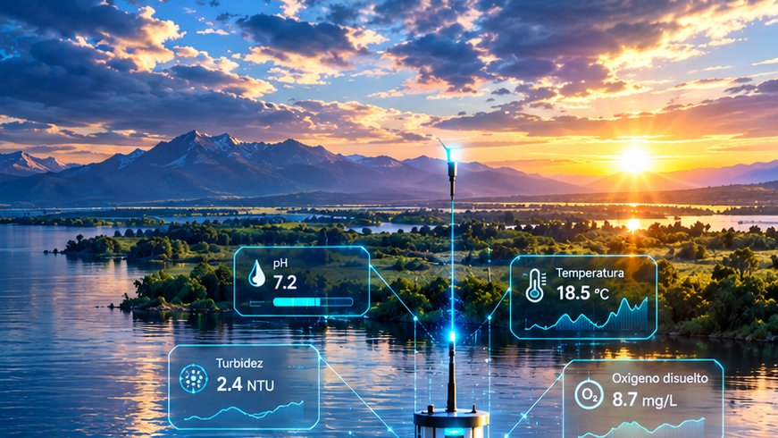

# AquaVigía: monitoreo y predicción de la calidad del agua en tiempo real

**Equipo 02 · Big Data · Universidad Peruana Unión · IX ciclo**

Integrantes: Celia Patricia Apaza Hilasaca y Jhenderson Aaron Machaca Mamani. Docente: Abel Ángel Sullón Macalupú.

## Qué es

AquaVigía responde una pregunta: **¿cómo anticipar el deterioro de la calidad del agua combinando el histórico con las lecturas en tiempo real?** En la Unidad 1 la respondimos por lotes; en la Unidad 2 la llevamos a tiempo real, con un pipeline que ingiere lecturas **reales** de sensores del USGS (Servicio Geológico de los Estados Unidos), las procesa con Spark Structured Streaming, aplica un modelo de series de tiempo y publica eventos de negocio en Kafka, con observabilidad en Grafana.

## Dimensiones

| Integrante | Variables | Evento de negocio | Documentación |
|---|---|---|---|
| Patricia Apaza | temperatura y oxígeno disuelto | orden de inspección (`orden-eventos`) | [Producto U2](patricia/u2-producto.md) · [Costos](patricia/costos.md) |
| Jhenderson Machaca | pH y turbidez | alerta de calidad (`alerta-eventos`) | [Producto U2](jhenderson/u2-producto.md) · [Costos](jhenderson/costos.md) |

Las dos dimensiones comparten la ingesta (`agua-usgs-eventos`) y el tablero de Grafana; cada una tiene su modelo, su umbral y su evento de negocio.

## Cifras clave

| | Patricia | Jhenderson |
|---|---|---|
| Mensajes verificados (100 % válidos) | 6 072 | 9 867 |
| Watermark medido | 85 min | 85 min |
| Mejora del modelo sobre repetir el último valor (RMSE) | +45,1 % y +32,1 % | +9,4 % y +4,2 % |
| Eventos de negocio publicados | 1 orden | 7 alertas |

## Código

El código está en el repositorio, en `pyspark/sesiones/AquaVigia_Producto_U2/`, con una carpeta por integrante: productor del USGS, cuadernos `12a` (streaming), `12b` (modelo) y `12c` (negocio y métricas), y el tablero de Grafana.

!!! note "Fuente de datos"
    Los sensores del USGS son estaciones reales de monitoreo en Maryland y Virginia, consultadas por su API pública. La fuente está declarada en el Brief del proyecto y fue aceptada por el docente. La clave de la API se usa solo como variable de entorno y nunca se versiona.
