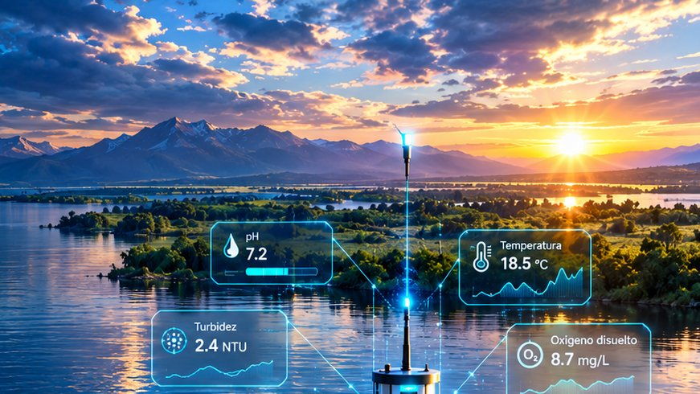

# AquaVigía: monitoreo y predicción de la calidad del agua

**Equipo 02 · Big Data · Escuela Profesional de Ingeniería de Sistemas · Universidad Peruana Unión, Juliaca · IX ciclo, 2026-2**

| | |
|---|---|
| Integrantes | Celia Patricia Apaza Hilasaca · Jhenderson Aaron Machaca Mamani |
| Docente | Abel Ángel Sullón Macalupú |
| Repositorio | [github.com/Patricia-Apaza/Big-Data-Contaminacion-del-Agua-](https://github.com/Patricia-Apaza/Big-Data-Contaminacion-del-Agua-) |
| Producto | Producto de la Unidad 3 (Producto Final del curso): [u3-producto](u3-producto.md) |

## Problema

Las estaciones de monitoreo de cuencas, lagos y pozos generan mediciones dispersas entre sensores automáticos y muestreos de laboratorio. No hay un sistema que combine el histórico con las lecturas en vivo para **anticipar** un episodio de deterioro de la calidad del agua antes de que se convierta en un riesgo sanitario o ambiental.

Pregunta central: **¿cómo anticipar el deterioro de la calidad del agua combinando el histórico con las lecturas en tiempo real?**

## Solución

Un sistema Big Data con arquitectura **Lambda**, integrado en una sola ejecución:

- **Capa batch (Unidad 1).** Spark procesa 1 250 000 mediciones de 180 estaciones, valida su calidad y deja una salida Parquet particionada por región (1 245 817 filas). Sobre ella se entrenan los modelos de la Unidad 1.
- **Capa de velocidad (Unidad 2).** Lecturas **reales** de 13 sensores del USGS (Servicio Geológico de los Estados Unidos) entran por MQTT, pasan a Kafka y las procesa Spark Structured Streaming. Un modelo de series de tiempo pronostica el valor de la próxima hora y calcula el riesgo de salir del rango de la estación.
- **Decisión.** Cuando el riesgo pasa de 0,5, el sistema publica un evento de negocio en Kafka: una **orden de inspección** (Patricia) o una **alerta de calidad** (Jhenderson).
- **Observabilidad.** Métricas en Prometheus y un tablero de Grafana con el estado del flujo, el pronóstico, el riesgo y la última ejecución integrada.
- **DataOps (Unidad 3).** El sistema se levanta con un solo script, con comprobación de salud en cada servicio, y se verifica con una ejecución integrada que tiene compuertas de calidad y deja un manifiesto.

## Dimensiones del equipo

| Integrante | Unidad 1 (batch) | Unidad 2 (tiempo real) | Evento de negocio |
|---|---|---|---|
| Patricia Apaza | porcentaje de mediciones fuera de rango por estación y mes | temperatura y oxígeno disuelto | orden de inspección (`orden-eventos`) |
| Jhenderson Machaca | pH y turbidez promedio por estación y mes | pH y turbidez | alerta de calidad (`alerta-eventos`) |

## Cómo recorrer esta documentación

| Si quiere... | Vaya a |
|---|---|
| Levantar el sistema desde cero | [Instalación y ejecución](instalacion.md) |
| Probar el flujo completo | [Uso del sistema](uso.md) |
| Entender los componentes | [Arquitectura](arquitectura.md), [Módulos](modulos.md) y [Datos](datos.md) |
| Ver que funciona | [Pruebas y evidencias](evidencias.md) |
| Saber quién hizo qué | [Equipo y aporte individual](equipo.md) |
| Revisar el repositorio | [Repositorio y estándares](repositorio.md) |
| Conocer los límites | [Limitaciones y mejoras](limitaciones.md) |

!!! note "Fuentes de datos"
    El dataset de la Unidad 1 es una **muestra simulada** con rangos realistas inspirados en los estándares de la Autoridad Nacional del Agua (ANA) del Perú, como declara el Brief. Las lecturas de la Unidad 2 son **reales**, de 13 estaciones del USGS en el este de los Estados Unidos, consultadas por su API pública. La clave de la API se usa solo como variable de entorno y nunca se versiona.
