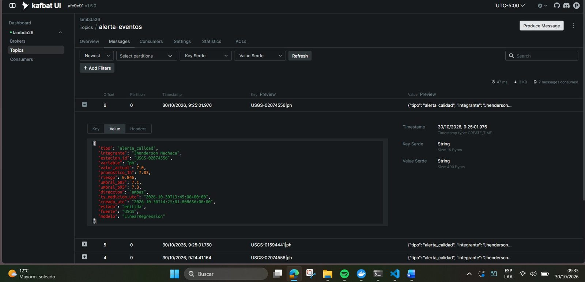
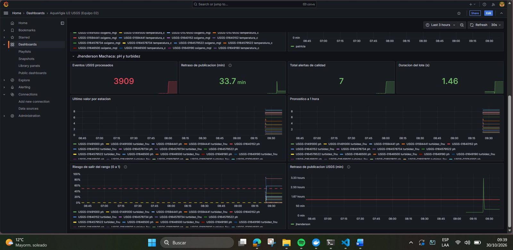

# Big Data: Producto de Unidad 2: AquaVigía (dimensión U2 de Jhenderson Machaca)

**Equipo 02 · Proyecto Sello AquaVigía · Big Data (Curso 262) · UPeU**

Pipeline en tiempo real de AquaVigía con **datos reales de sensores del USGS** (EE. UU.): ingesta con Kafka, procesamiento con Spark Structured Streaming (ventana, watermark y checkpoint), observabilidad con Prometheus y Grafana, estimación de costos, y un modelo de series de tiempo cuyo pronóstico y riesgo se ven en el mismo tablero.

Mi dimensión: **pH (`ph`) y turbidez (`turbidez_fnu`)**. Mi evento de negocio es la **alerta de calidad** (`alerta_calidad`, tópico `alerta-eventos`). Todas las cifras salen de mis propias corridas del 30-oct-2026 en la laptop compartida del equipo; donde algo es una limitación o una hipótesis, está dicho.

## Versión 3 para la evaluación S12

Esta sección resume lo que se agregó para cubrir todo el temario de la evaluación S12 (S6 a S11). Las secciones siguientes documentan la ejecución v2 del 30 de octubre, que sigue siendo la evidencia de ventana, watermark medido, checkpoint y dato tardío.

### Evolución desde la Unidad 1

| | Unidad 1 (batch) | Unidad 2 (streaming) |
|---|---|---|
| Pregunta | ¿Cuál fue el pH y la turbidez promedio por estación y por mes, y qué valores se esperan el mes siguiente? | ¿Qué pH y turbidez tendrá cada estación dentro de una hora, y con qué probabilidad saldrá de su rango? |
| Fuente | Muestra simulada con rangos de la ANA | 13 estaciones reales del USGS, una lectura cada 5 min |
| Proceso | Spark batch, promedios mensuales y regresión sobre la serie mensual | Spark Structured Streaming sobre cada lectura |
| Salida | Tabla y gráfico de tendencia en el cuaderno | Alerta de calidad en Kafka y fila propia en Grafana |
| Decisión | Priorizar el mantenimiento del mes | Alerta operativa inmediata |
| Resultado del modelo | Regresión con R² cercano a 0 (RMSE 0,035): el pH mensual casi no varía | RMSE 9,4 % y 4,2 % menor que la persistencia; riesgo con AUC 0,977 (pH) y 0,987 (turbidez) |

### Qué cubre cada tema del temario

| Sesión | Evidencia |
|---|---|
| S6 | `12d_ingesta_semantica_jhenderson`, sección 1: particiones y offsets, contrato con `version_esquema` 2 leído por un consumidor de la versión 1. Alerta de calidad con `version_esquema` 1 y `evento_id` determinista (idempotente). |
| S7 | Productor por MQTT (`usgs_productor.py --salida mqtt`), Mosquitto y puente `bridge_mqtt_kafka_usgs.py` (carpeta `uso-agua-usgs`). Tópico `agua-usgs-eventos-v2` con 3 particiones y key `estacion_id`. 12d, sección 2: frecuencia frente al evento de negocio, una partición por estación, cabecera `canal = mqtt`, validación de esquema y de rango físico con tres mensajes de prueba. |
| S8 | 12a v2: ventana de 15 min, watermark de 85 min medido, checkpoint y dato tardío. 12d, secciones 3 y 4: deduplicación dentro del watermark (reenvío de 50 lecturas: +50 sin deduplicar, +0 con deduplicación) y ventana fija frente a deslizante. |
| S9 | Tablero `grafana_aquavigia_u2_usgs_v3.json`: lag del consumidor, throughput, disponibilidad de Kafka y del Pushgateway, segundos desde el último lote, duración del lote y retraso, con umbrales. |
| S10 | 12b: persistencia primero y corte cronológico. `12c_negocio_usgs_jhenderson_v3`, sección 2: el pronóstico sale de un solo mensaje. Sección 7.1: el único operador con estado es la deduplicación. |
| S11 | 12c v3, secciones 4 y 5: error medido en vivo (modelo y persistencia) y panel batch estático con el RMSE de validación, lado a lado en Grafana junto a los KPI. |

### Contrato del evento IoT, versión 2

Igual que la versión 1, más `version_esquema = 2` y `contexto`:

- `contexto.rezagos`: valores de la misma variable 5, 10, 15, 30 y 60 minutos antes (`l1`, `l2`, `l3`, `l6`, `l12`).
- `contexto.simultaneas`: valores de las otras variables de la estación en el mismo bloque de 5 minutos.

Tamaño medio: unos 500 bytes (medido sobre 2 221 eventos v2 reales), frente a 322 de la versión 1.

### Decisión propia distinta al ejemplo del docente

En el ejemplo del curso, el modelo se valida una vez, fuera de línea, y se lleva a producción. Mi mejora sobre la persistencia es pequeña (+9,4 % en pH y +4,2 % en turbidez, y en MAE no le gana), así que no basta con validarlo una vez. El 12c v3 compara cada pronóstico con la lectura real una hora después, y también lo que habría dicho la persistencia, y lo muestra en Grafana junto al RMSE de validación. La regla: si la persistencia gana de forma sostenida en vivo, se vuelve a ella y se reentrena. Ese registro de pronósticos pendientes es estado de monitoreo, no de inferencia: la inferencia sigue siendo sin estado porque los rezagos viajan en el evento.

### Episodio de la demostración

Se reproduce por MQTT un tramo real del periodo de prueba: del 16-oct-2026 22:00 al 17-oct-2026 04:00 UTC, con el umbral de operación 0,5. En la prueba previa a la sustentación, ese tramo generó 24 alertas de calidad (pH y turbidez en 6 estaciones), y el RMSE en vivo del modelo fue menor que el de la persistencia en las dos variables. Los valores definitivos son los que muestra el cuaderno ejecutado.

### Rúbrica de la Unidad 2 y trazabilidad (u2-producto, Tabla 2)

| Criterio | Peso | CE / Nivel | Evidencia en esta dimensión |
|---|---|---|---|
| 1. Ingesta de eventos empresariales mediante Kafka | 12 % | apoyo | Alerta de calidad publicada y consumida en vivo en `alerta-eventos` por el 12c v3; contrato con `version_esquema` y `evento_id` idempotente |
| 2. Ingesta de eventos IoT/sensores | 10 % | apoyo | USGS por MQTT y puente a `agua-usgs-eventos-v2` (3 particiones, key estación); esquema y rango físico validados (12d) |
| 3. Procesamiento streaming con Spark Structured Streaming | 14 % | apoyo | Ventana, watermark medido y checkpoint (12a); deduplicación y ventana fija frente a deslizante (12d); watermark, deduplicación y checkpoint activos en el 12c v3 |
| 4. Observabilidad con métricas y tableros | 12 % | apoyo | Tablero v3: lag, throughput, disponibilidad, duración del lote y segundos desde el último lote, con umbrales |
| 5. Estimación de costos y criterios de escalado | 8 % | apoyo | Documento de costos con volumen medido (500 B por evento v2), precios oficiales y umbrales de escalado |
| 6. Salidas BI/ML distribuidas | 12 % | CE044-N3 | KPI de negocio junto a pronóstico y riesgo en la misma sesión; panel batch al lado del error en vivo |
| 7. Series de tiempo o inferencia validada | 12 % | CE043-N3 (completa) | 12b: persistencia primero y corte cronológico; 12c v3: inferencia sin estado y error en vivo; 12e: ROC del riesgo y curva de aprendizaje |
| 8. Sustentación | 20 % | CG | Demo en vivo de 3 minutos y respuestas a la Tabla 1 de S12 |

Nota final = suma de (peso x puntos) / 100 x 20. El criterio 6 evidencia CE044 Nivel 3 completo y el criterio 7 completa la segunda mitad de CE043 Nivel 3 (la primera mitad se evidenció en la Unidad 1).

### Archivos de la versión 3

`usgs_productor.py` (contrato v2 y salida MQTT), `uso-agua-usgs/` (Mosquitto y puente), `12d_ingesta_semantica_jhenderson.ipynb`, `12c_negocio_usgs_jhenderson_v3.ipynb`, `12e_evaluacion_riesgo_jhenderson.ipynb` y `grafana_aquavigia_u2_usgs_v3.json`.

## 0. Qué es real

- **Fuente:** estaciones reales de monitoreo de calidad de agua del USGS (Maryland y Virginia), leídas por su API pública. No son dispositivos propios. El docente aceptó la fuente externa de forma verbal.
- **Capa batch:** historial de 90 días (1 309 777 lecturas en total; 663 774 de mis dos variables, de 2026-08-01 a 2026-10-30) para entrenar el modelo.
- **Capa de velocidad:** lecturas nuevas del USGS a Kafka (`agua-usgs-eventos`), compartidas con la dimensión de Patricia (temperatura y oxígeno).
- **Propio de mi dimensión:** las variables, el modelo, el evento de negocio `alerta_calidad`, mis cuadernos `12a`, `12b` y `12c` y mi fila del tablero.

La evidencia de las sesiones previas está en mis informes S06 a S11; este documento describe el pipeline integrado de S12.

## 1. Arquitectura (Lambda)

```
USGS (sensores reales, API publica)
   |  historial 90 dias (usgs_productor.py historial)  --> data/historial.jsonl  (capa batch: entrenamiento)
   |  lecturas nuevas cada 120 s (usgs_productor.py publicar)
   v
Kafka: agua-usgs-eventos (1 particion, key = estacion_id)
   v
Spark Structured Streaming (agua-pyspark)
   ventana 15 min + watermark 85 min + checkpoint
   PipelineModel (pronostico a 1 hora) -> riesgo de salir del rango
   |                                   |                       |
   v                                   v                       v
Parquet (artifacts)      Kafka: alerta-eventos (alerta_calidad)   Pushgateway :49091
                                                              |
kafka-exporter --> Prometheus :49090 <------- scrape ---------+
                          |
                    Grafana :43000  (tablero unico "AquaVigia U2 USGS (Equipo 02)")
```

Servicios: `lambda26-kafka`, `lambda26-kafka-exporter`, `lambda26-kafka-ui` (:48085), `agua-pyspark` (Jupyter :4488, Spark UI :4042), `lambda26-pushgateway`, `lambda26-prometheus` y `lambda26-grafana`.

## 2. Alcance de capacidades por sesión (Tabla 1)

| Sesión | Capacidad que agrega | Mi evidencia |
|---|---|---|
| S6 | Ingesta de eventos empresariales | Alerta de calidad (`alerta_calidad`) publicada por Spark en `alerta-eventos` a partir del riesgo pronosticado, con contrato versionado y `evento_id` idempotente (sección 3 y 12c v3) |
| S7 | Ingesta de eventos IoT/sensores | Lecturas USGS de pH y turbidez por MQTT y puente a Kafka, key por estación, esquema y rango físico validados (sección 4 y 12d) |
| S8 | Procesamiento streaming | Ventana de 15 min, watermark de 85 min medido, checkpoint, dato tardío y Parquet (12a); deduplicación y ventana fija frente a deslizante (12d) |
| S9 | Observabilidad y costos | Tablero v3 con lag, throughput, disponibilidad y umbrales, y [costos](costos.md) con el volumen medido (sección 5) |
| S10 | Series de tiempo e inferencia | Pronóstico a 1 hora de pH y turbidez validado contra la persistencia con corte cronológico (12b); inferencia sin estado (12c v3); ROC del riesgo y curva de aprendizaje (12e) |
| S11 | BI/ML distribuido | Alertas junto a valor, pronóstico y riesgo en el mismo tablero; RMSE de validación al lado del error en vivo (sección 6) |
| S12 | Pipeline integrado y sustentado | Este documento, los cuadernos 12a, 12b, 12c v3, 12d y 12e, y el tablero `grafana_aquavigia_u2_usgs_v3.json` |

## 3. Contratos de eventos



**Evento de sensor** (`agua-usgs-eventos`, 1 partición, key `estacion_id`, productor `usgs_productor.py`):

```json
{ "evento_id": "2e26d2f2-3ffb-46f6-9867-4f98dc2c71f4", "estacion_id": "USGS-01491000",
  "variable": "nitrato_mgl", "codigo_parametro": "99133", "valor": 1.59,
  "fecha_medicion_utc": "2026-10-30T14:30:00+00:00",
  "fecha_ingesta_utc": "2026-10-30T14:38:25.392387+00:00",
  "retraso_min": 8.4, "origen": "vivo", "fuente": "USGS" }
```

(Mensaje real tomado de Kafka UI, offset 10788.) El tiempo del evento es `fecha_medicion_utc` (cuando midio el sensor), no la hora de llegada: es la base de la ventana y del watermark. `origen` distingue `vivo`, `historial` y `reproduccion`/`replay` (lecturas reenviadas para pruebas, declaradas). Variables del tópico: ph, oxígeno_mgl, turbidez_fnu, temperatura_c, conductividad_uscm y nitrato_mgl, en 12 estaciones (66 series estación por variable).

**Evento de negocio** (`alerta-eventos`, 1 partición, key `estacion_id|variable`): una `alerta_calidad` se emite cuando el riesgo pronosticado de salir del rango supera `RIESGO_ALERTA` (0,5), con enfriamiento de 60 minutos de tiempo de evento por estación y variable. Estado inicial `emitida`.

```json
{ "tipo": "alerta_calidad", "integrante": "Jhenderson Machaca",
  "estacion_id": "USGS-02074556", "variable": "ph",
  "valor_actual": 7.0, "pronostico_1h": 7.03, "riesgo": 0.846,
  "umbral_p05": 7.1, "umbral_p95": 7.3, "direccion": "ambas",
  "ts_medicion_utc": "...", "creado_utc": "...",
  "estado": "emitida", "fuente": "USGS", "modelo": "LinearRegression" }
```

(Valores tomados de la tabla de riesgo del 12c; las fechas dependen de la corrida. Los mensajes reales estan en Kafka UI, tópico `alerta-eventos`.) La direccion que preocupa es `ambas` para pH y `alta` para turbidez.

## 4. Procesamiento streaming (12a)

- **Ingesta verificada:** 9 867 mensajes en el tópico al momento de la corrida, 100 % válidos según el contrato; 3 600 de mis variables y 3 553 eventos únicos (47 son reenvíos de las pruebas). Doce estaciones con pH y once con turbidez (`USGS-01579550` no mide turbidez en este flujo).
- **Retraso real y watermark:** ventana limpia n=138, mediana 28, p90 58, p99 71 min. Incluyendo los cortes de red de la laptop (n=2 087) el p99 sube a 178. Watermark = max(60, redondeo a 5 de p99 por 1,2) = **85 minutos**, calculado con la ventana limpia. Es una muestra pequeña.
- **Sin watermark el estado crece:** filas de salida por micro-lote en modo `complete`: 382, 757, 1 109 y 1 221.
- **Con watermark y checkpoint:** 5 micro-lotes (batchId 0 a 4; el último llegó vacio porque ya no había datos nuevos). Al reiniciar con el mismo checkpoint el batchId continua en **5** (no vuelve a 0).
- **Dato tardío:** se reenvió una lectura de turbidez con 800 min de brecha frente a un watermark de 85. Con watermark su ventana **no** aparece (False); sin watermark **si** aparece (True).
- **Salida persistente:** 1 265 ventanas guardadas en Parquet con checkpoint.

## 5. Observabilidad y costos




- **Métricas al Pushgateway** (`job/u2_usgs/instance/jhenderson`): eventos, lotes, alertas, retraso medio, duración del lote, y por estación y variable el último valor, el pronóstico a 1 hora y el riesgo. En Grafana mi fila mostró 3 909 eventos procesados, 7 alertas, retraso de publicacion de 33,7 min (promedio del último lote) y lote de 1,46 s.
- **Volumen real del tópico:** 66 series (estación por variable, las 6 variables del tópico), 322 bytes por evento, regimen estable de 19 008 eventos al día (6,11 MB/día, 0,183 GB/mes). Mis dos variables suman 23 de esas series (12 de pH y 11 de turbidez): 6 624 eventos al día, unos 2,1 MB/día (calculo por multiplicacion, 23 por 288 por 322 bytes).
- **Costos y criterios de escalado:** ver [costos](costos.md) (servicio administrado frente a máquina propia, con enlaces; precios y límites verificados el 30-oct-2026).

## 6. Series de tiempo y BI/ML (12b y tablero)

Pronóstico a 1 hora (12 pasos de 5 min). Variables: valor actual, rezagos (1, 2, 3, 6 y 12 pasos), cambio de la última hora, el valor de la otra variable y hora del día (seno y coseno). Corte cronológico 80/20 en 2026-10-12 01:55 UTC (entrenamiento 250 477 filas, prueba 64 451).

| Variable | Modelo | RMSE | MAE | R2 |
|---|---|---|---|---|
| ph | Repetir el último valor | 0.0753 | 0.0278 | 0.9810 |
| ph | Media de entrenamiento | 0.5515 | 0.4048 | -0.0155 |
| ph | **LinearRegression** | **0.0683** | 0.0375 | 0.9844 |
| ph | RandomForest | 0.0855 | 0.0430 | 0.9756 |
| turbidez_fnu | Repetir el último valor | 8.5651 | 0.9464 | 0.6973 |
| turbidez_fnu | Media de entrenamiento | 15.5956 | 6.0472 | -0.0037 |
| turbidez_fnu | **LinearRegression** | **8.2011** | 1.1755 | 0.7225 |
| turbidez_fnu | RandomForest | 13.3286 | 1.9243 | 0.2669 |

Mejora del RMSE frente a repetir el último valor: pH **+9,4 %** (material) y turbidez **+4,2 %** (marginal, menos de 5 %). **El MAE del modelo es peor que el de repetir el último valor en las dos variables** (0,0375 contra 0,0278 en pH; 1,18 contra 0,95 en turbidez): el modelo reduce los errores grandes pero no el error típico. En turbidez el RMSE lo dominan los picos grandes (hay estaciones con percentil 95 de 53,8 FNU); que el modelo no los anticipe bien es una hipótesis, no una conclusión verificada. RandomForest rindió peor que la regresión lineal, sobre todo en turbidez.

**Riesgo y evento de negocio (12c, modo reproducción, umbral de operación 0,5):** 4 lotes, 3 909 eventos, 82 pronósticos y **7 alertas** en `alerta-eventos`, todas de pH (`USGS-01646500`, `USGS-02074556` y `USGS-01594441`); ninguna de turbidez (riesgo máximo 0,34). El riesgo máximo fue 0,8464 en `USGS-02074556` (pH 7,0 con banda de advertencia de 7,1 a 7,3). La alerta significa "fuera del rango habitual de esa estación", no una violación de una norma; como el modelo mejora poco sobre repetir el último valor, estas alertas vienen sobre todo del valor actual y no de un empeoramiento pronosticado.

## 7. Limitaciones conocidas

- El USGS mide cada 5 minutos pero publica por tandas con retraso. El watermark de 85 minutos sale de una ventana limpia pequeña (unos 140 eventos); con los cortes de red de la laptop el p99 sube. Es una medición corta, no una caracterización definitiva.
- Las pruebas de reinicio y de dato tardío reenvían lecturas reales duplicadas al tópico para generar trabajo. Se declaran como pruebas; por eso hay más mensajes que eventos únicos.
- Las órdenes o alertas se publican solo en Kafka; no se conectaron a ningún servicio de negocio posterior.
- El modelo se valida con una sola partición cronológica de unas 2,5 semanas (80/20), no con validación repetida. Los umbrales de advertencia son estadísticos (percentiles 5 y 95 del entrenamiento de cada estación), no una norma de calidad del agua.
- Las pruebas corren en una sola laptop compartida; el cuaderno 12c se ejecutó en modo `reproduccion` (lee lo ya guardado del tópico), por eso `ts_medicion_utc` de un evento puede ser horas anterior a `creado_utc`.
- Los precios de COSTOS se verificaron en las páginas oficiales el 30-oct-2026 y pueden cambiar después; el costo se calcula con el volumen de todo el tópico (6 variables) y la opción de máquina propia no incluye disco ni transferencia.
- La clave de la API del USGS se usa solo como variable de entorno y nunca se versióna.

## 8. Reproducibilidad

1. Docker con Kafka, Prometheus, Grafana, Pushgateway y el contenedor `agua-pyspark` arriba (`docker ps`). Verifica en `http://localhost:49090/targets` que los targets estén UP.
2. Crear a mano los tópicos (`AUTO_CREATE_TOPICS_ENABLE=false`): `agua-usgs-eventos` y `alerta-eventos`.
3. Clave gratuita del USGS (https://api.waterdata.usgs.gov/signup). Se pone solo como variable de entorno: `set USGS_API_KEY=...` (CMD).
4. Historial de 90 días: `py usgs_productor.py historial --estaciones <lista> --dias 90 --variables temperatura_c,oxigeno_mgl,ph,turbidez_fnu` y copiar `historial.jsonl` a `s12-u2-usgs/data/` (no se sube a git: supera el límite de GitHub).
5. Tiempo real: `py usgs_productor.py publicar --estaciones <lista> --cada 120 --salida kafka --periodo PT3H`.
6. En Jupyter (`http://localhost:4488`), carpeta `s12-u2-usgs`, correr en orden `12a_streaming_usgs_jhenderson_v2`, `12b_modelo_usgs_jhenderson` y `12c_negocio_usgs_jhenderson_v2`, celda por celda y con un solo kernel abierto.
7. Grafana (`http://localhost:43000`): importar `grafana_aquavigia_u2_usgs.json` con Prometheus como fuente.

## 9. Trazabilidad con la rúbrica

| Criterio | Dónde está la evidencia |
|---|---|
| 1. Ingesta empresarial | Sección 3 (contrato del evento de negocio) y cuaderno 12c, secciones 3 y 6 (lectura del tópico de negocio) |
| 2. Ingesta IoT | Secciones 0 y 3 (contrato USGS), cuaderno 12a, secciones 2 y 3 |
| 3. Streaming con Spark | Sección 4, cuaderno 12a, secciones 4.1 a 4.5 |
| 4. Observabilidad | Sección 5, cuaderno 12c (sección 4, métricas) y tablero `AquaVigia U2 USGS` |
| 5. Costos y escalado | Sección 5 y [costos](costos.md) |
| 6. Salidas BI/ML | Sección 6 y tablero de Grafana (KPIs, último valor, pronóstico y riesgo en la misma pantalla) |
| 7. Series de tiempo validadas | Sección 6, cuaderno 12b |
| 8. Sustentación | Guion de demo y preguntas del jurado |
