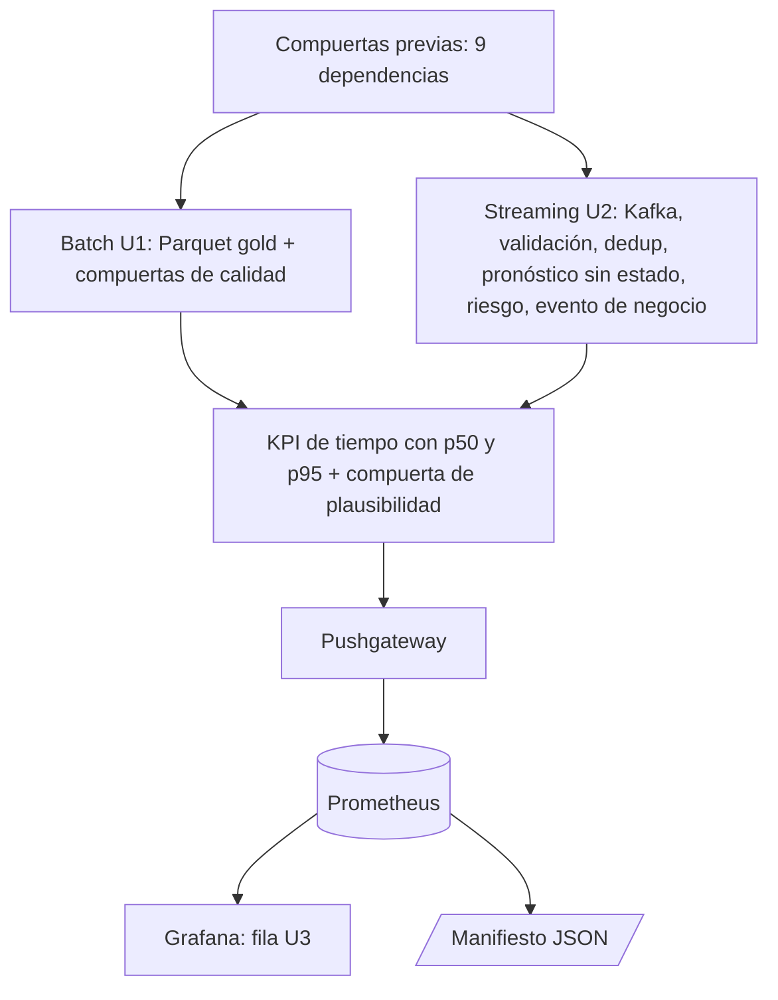

# Ejecución integrada (S13)

Cuadernos: `pyspark/sesiones/AquaVigia_Producto_U3/<integrante>/13_integracion_<integrante>.ipynb`. En una sola corrida comprueban sus dependencias, procesan el batch de la Unidad 1, procesan el streaming de la Unidad 2 con el modelo en una ventana fija, publican sus métricas en Prometheus y escriben un manifiesto.

## 1. Flujo de la ejecución



## 2. Dependencias

| Componente | Necesita | Compuerta previa |
|---|---|---|
| Batch U1 | `AquaVigia_Producto_U1/<integrante>/artifacts/mediciones_particionado` (lo genera `04_producto_u1_<integrante>.ipynb`) | Parquet de la U1 (gold) existe |
| Batch U1 | Modelo de la U1 (lo genera el mismo cuaderno) | Modelo de la U1 existe |
| Streaming U2 | `AquaVigia_Producto_U2/<integrante>/artifacts/modelos_<integrante>` (lo genera `12b_modelo_usgs_<integrante>.ipynb`) | Modelos de la U2 existen |
| Streaming U2 | Kafka con `agua-usgs-eventos-v2` con mensajes y el tópico de negocio | Kafka: tópico con datos; tópico de negocio existe |
| Ingesta | Mosquitto y el productor enviando | MQTT acepta conexiones |
| Observabilidad | Pushgateway, Prometheus y Grafana | Pushgateway listo; Prometheus listo; Grafana saludable |

## 3. Pasos de ejecución

1. `powershell -ExecutionPolicy Bypass -File scripts\levantar.ps1` (o, antes del hardening, los contenedores ya levantados).
2. Jupyter (`http://localhost:4488`) → `AquaVigia_Producto_U3/<integrante>/13_integracion_<integrante>.ipynb` → Kernel → Restart Kernel and Run All Cells. Un solo cuaderno a la vez: dos kernels que arrancan juntos se bloquean al resolver el conector de Kafka (bitácora, fila 2).
3. Cuando el cuaderno imprime `Streaming 240 s ...`, en otra terminal se arranca el productor. El streaming lee solo lo nuevo (`latest`), así que lo enviado antes no entra. `--velocidad` es lecturas por segundo, no un multiplicador:
   ```
   py usgs_productor.py reproducir --archivo historial.jsonl --desde 2026-10-16T22:00 --hasta 2026-10-17T04:00 --velocidad 10 --salida mqtt
   ```
   El archivo `historial.jsonl` se genera una vez con el modo `historial` del productor (90 días; no se versiona por su tamaño).
4. Grafana → carpeta AquaVigia → tablero "AquaVigia U3: sistema integrado (Equipo 02)" → fila "Ejecución integrada U3".

## 4. Corridas y comparación de manifiestos

### Corridas de Patricia

Dos corridas de Patricia el 13/11/2026, mismo cuaderno y mismos parámetros (streaming de 240 s, disparador de 10 s, umbral de riesgo 0,5). Solo cambió el tramo que reprodujo el productor. Los manifiestos completos están en [`evidencias/manifiestos/`](evidencias/manifiestos/).

| Indicador | Corrida 1 | Corrida 2 |
|---|---|---|
| runId | 20261113T102832Z | 20261113T104634Z |
| Tramo reproducido (UTC) | 16/10 desde 20:00, 5 lecturas/s | 16/10 22:00 a 17/10 04:00, 10 lecturas/s |
| Compuertas que pasan | 21 de 21 | 21 de 21 |
| Filas batch U1 | 1 245 817 | 1 245 817 |
| Micro-lotes (con datos) | 20 | 23 (22) |
| Pronósticos | 427 | 971 |
| Eventos de negocio (en Kafka) | 0 (0) | 4 (4) |
| Riesgo máximo | 0,497 | 0,745 |
| Latencia p50 / p95 / máx. | 7,2 s / 11,9 s / 12,8 s | 7,4 s / 11,9 s / 12,9 s |
| Micro-lote p50 / p95 | 2 886 ms / 3 100 ms | 2 883 ms / 3 642 ms |
| RMSE vivo temperatura, modelo / persistencia | 0,2067 / 0,1394 (69 comp.) | 0,1127 / 0,1921 (341 comp.) |
| RMSE vivo oxígeno, modelo / persistencia | 0,1946 / 0,2790 | 0,1210 / 0,1962 (342 comp.) |
| Métricas confirmadas en Prometheus | 15 de 15 | 15 de 15 |
| Advertencias | 1 | 0 |
| Duración total | 256,5 s | 254,8 s |

**Lectura.**

- **Lo que no cambió es el procedimiento:** mismas compuertas, mismas dependencias y el mismo batch (1 245 817 filas). Las latencias también se mantuvieron: p50 de unos 7 s y p95 de 12 s, muy por debajo del límite de 60 s. No hay regresión.
- **Lo que cambió son las lecturas.**
  - La corrida 1 cubrió unas 2 horas antes del episodio. El riesgo quedó en 0,497, por debajo del umbral, así que no emitió eventos.
  - La corrida 2 cayó dentro del episodio y emitió 4 eventos. Los 4 aparecieron en `orden-eventos`: la compuerta comparó los offsets antes y después.
- **Advertencia de la corrida 1.** Con solo 69 comparaciones en un tramo de temperatura casi constante, la persistencia ganó al modelo. El cuaderno lo registró como advertencia y no lo ocultó. En la corrida 2, con 341 comparaciones, el modelo ganó en las dos variables. Los valores quedan cerca del RMSE de validación del 12b: 0,1299 en temperatura y 0,1422 en oxígeno.
- **Límite.** Son dos corridas de 4 minutos. Sirven para comprobar que el sistema integrado funciona y es repetible, no para evaluar el modelo a largo plazo.

### Corridas de Jhenderson

| Indicador | Corrida fallida | Corrida tras la corrección |
|---|---|---|
| runId | 20261113T110211Z | 20261113T112336Z |
| Gold de la U1 | 794 866 filas, 5 regiones | 1 245 817 filas, 8 regiones |
| Compuertas | Se detuvo en la sección 2: `FALLA Completitud` | 21 de 21 |
| Pronósticos | sin streaming | 1 043 |
| Eventos de negocio (en Kafka) | sin streaming | 15 (15) |
| Riesgo máximo | sin streaming | 1,000 |
| Latencia p50 / p95 / máx. | sin streaming | 7,5 s / 11,9 s / 12,7 s |
| Micro-lote p50 / p95 | sin streaming | 2 974 ms / 3 258 ms |
| RMSE vivo pH, modelo / persistencia | sin streaming | 0,0570 / 0,0703 (366 comp.) |
| RMSE vivo turbidez, modelo / persistencia | sin streaming | 6,2517 / 7,8381 (365 comp.) |
| Métricas confirmadas en Prometheus | no publicó | 15 de 15 |
| Manifiesto | no se escribe (se detiene antes de la sección 6); evidencia en [texto](evidencias/jhenderson_corrida_fallida_20261113T110211Z.txt) | [`evidencias/manifiestos/`](evidencias/manifiestos/) |

**Lectura.**

- La corrida fallida muestra que la ejecución se detiene en la compuerta que corresponde y no publica nada con datos incompletos.
- Tras regenerar el gold, la misma ventana del episodio que usó Patricia produjo 15 eventos, y los 15 están en `alerta-eventos`. Un riesgo de 1,000 significa que el pronóstico quedó tan lejos del umbral de la estación que la probabilidad de cruzarlo, redondeada, es 1. Los eventos con su variable y estación están en `alerta-eventos`.
- En pH el modelo gana en RMSE (0,0570 frente a 0,0703), pero en MAE la persistencia es algo mejor (0,0396 frente a 0,0411). El modelo reduce los errores grandes, no el error típico. En turbidez el modelo gana en las dos métricas.

## 5. Bitácora de integración

| # | Hallazgo | Causa | Corrección | Prueba de corrección |
|---|---|---|---|---|
| 1 | Corrida 20261113T110211Z de Jhenderson detenida en la sección 2: `FALLA Completitud: 1 245 817 filas de la U1`. El gold tiene 794 866 filas y 5 regiones; faltan Arequipa, Lambayeque y Loreto (450 951 filas). Las otras compuertas de calidad pasaron, así que solo la de completitud detecta el problema ([evidencia](evidencias/jhenderson_corrida_fallida_20261113T110211Z.txt)). | Faltan en el disco 12 de los 32 archivos Parquet del gold, los de esas 3 regiones. El 04 verificó la escritura completa en su momento (celda de ida y vuelta), así que los archivos se perdieron después. No se pudo confirmar en qué paso. | Volver a ejecutar `04_producto_u1_jhenderson.ipynb`, que reescribe el gold con `mode("overwrite")` desde `data/`. | Corrida 20261113T112336Z: el 04 vuelve a escribir 32 archivos en 8 regiones (`Verificado: 1,245,817 filas`) con el mismo modelo de la U1 (RMSE 0,0355, R2 0,0008), y en el 13 pasan las 21 compuertas, incluida la de completitud. |
| 2 | Run All no mostraba salida en ninguna celda durante varios minutos. | Los cuadernos de los dos integrantes se iniciaron a la vez y los dos kernels quedaron esperando al resolver el paquete `spark-sql-kafka` en la misma caché de Ivy. | Apagar los dos kernels y ejecutar un solo cuaderno a la vez (paso 2 de la sección 3). | Corrida 20261113T102832Z completa: preflight en segundos y duración total de 256,5 s. |
| 3 | La corrida 1 terminó sin eventos de negocio. | No es un fallo: a 5 lecturas/s, los 240 s de streaming cubrieron el tramo previo al episodio (riesgo máximo 0,497 < 0,5). | Arrancar el productor cuando empieza el streaming y reproducir desde las 22:00 UTC a 10 lecturas/s. | Corrida 20261113T104634Z: 4 eventos emitidos y 4 confirmados en Kafka. |
